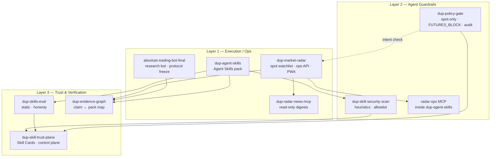

# Uladzimir Dabranski (D.U.P.) · DUP Labs

**Industrial fail-closed systems** for Agent Skills / MCP trust, market ops, and hybrid L1 R&D.  
Claims need packs on disk. No silent green. Not financial advice. Not a launched public mainnet.

```text
Beginner 60s path: clone dup-lab → make bootstrap → open in Cursor (skills+MCP auto-wired)
Tech-lead path: architecture ↓ → pin order ↓ → one-command demos ↓ → evidence honesty
```

## Start here (automatic wiring)

```bash
git clone https://github.com/Gruver87/dup-lab.git && cd dup-lab
make bootstrap          # Windows: .\scripts\bootstrap.ps1
# Open dup-lab/ (or dup-lab.code-workspace) in Cursor — skills + MCP already connected
```

Orchestrator: [`dup-lab`](https://github.com/Gruver87/dup-lab) — clones siblings, installs skills globally, writes `.cursor/mcp.json`, runs fixture demos.

## Architecture (3 layers)



**Crypto / Market Radar is the first combat stand** — the Trust & Guardrails layers are **generic patterns** for any high-stakes Agent Skills / MCP deployment (fintech, DevOps, regulated ops).

## Pin these (recommended order)

| # | Repo | Why pin |
|---|------|---------|
| 1 | [`dup-lab`](https://github.com/Gruver87/dup-lab) | **Start here** — one-command bootstrap |
| 2 | [`dup-skill-trust-plane`](https://github.com/Gruver87/dup-skill-trust-plane) | Control plane — Skill Cards, self-host API |
| 3 | [`dup-skills-eval`](https://github.com/Gruver87/dup-skills-eval) | Deterministic eval + E2E dashboard |
| 4 | [`dup-agent-skills`](https://github.com/Gruver87/dup-agent-skills) | Production skills pack under test |
| 5 | [`dup-policy-gate`](https://github.com/Gruver87/dup-policy-gate) | Spot-only policy before any order |
| 6 | [`dup-protocol`](https://github.com/Gruver87/dup-protocol) | Industrial L1 pin (separate evidence tree) |

> Pin in GitHub UI: Profile → Customize your pins → select the six above.

## One-command demos (Linux / macOS / Windows)

No Desktop paths. No KuCoin keys. No soak.

```bash
# Trust plane (fixtures + sibling gates optional for full stack)
git clone https://github.com/Gruver87/dup-skill-trust-plane.git && cd dup-skill-trust-plane
python -m pip install -e ".[dev]"
make demo

# Skills eval
git clone https://github.com/Gruver87/dup-skills-eval.git && cd dup-skills-eval
python -m pip install -e ".[dev]"
make demo

# Evidence graph (bundled mock products)
git clone https://github.com/Gruver87/dup-evidence-graph.git && cd dup-evidence-graph
python -m pip install -e ".[dev]"
make demo

# Radar news MCP (fixture digests; no live radar)
git clone https://github.com/Gruver87/dup-radar-news-mcp.git && cd dup-radar-news-mcp
python -m pip install -e ".[dev]"
make demo
```

PowerShell: `.\scripts\demo.ps1` in each repo. Policy gate: `.\scripts\demo_policy.ps1` / `make demo`.

## Repository map

| Layer | Repository | Role |
|-------|------------|------|
| Entry | [dup-lab](https://github.com/Gruver87/dup-lab) | Beginner orchestrator · `make bootstrap` |
| Trust | [dup-skill-trust-plane](https://github.com/Gruver87/dup-skill-trust-plane) | Orchestrates eval+security+policy → Skill Cards · `POST /v1/verify` |
| Trust | [dup-skills-eval](https://github.com/Gruver87/dup-skills-eval) | Static / honesty gate · [E2E board](https://github.com/Gruver87/dup-skills-eval#ecosystem-e2e-2026-11-17) |
| Trust | [dup-evidence-graph](https://github.com/Gruver87/dup-evidence-graph) | Query: can product X claim soak/ops_ready? |
| Guard | [dup-skill-security-scan](https://github.com/Gruver87/dup-skill-security-scan) | Install allowlist + threat heuristics |
| Guard | [dup-policy-gate](https://github.com/Gruver87/dup-policy-gate) | FUTURES_BLOCK · size caps · audit JSONL |
| Exec | [dup-agent-skills](https://github.com/Gruver87/dup-agent-skills) | Market-ops Agent Skills + read-only MCP |
| Exec | [dup-market-radar](https://github.com/Gruver87/dup-market-radar) | Spot watchlist / Telegram / PWA |
| Exec | [dup-radar-news-mcp](https://github.com/Gruver87/dup-radar-news-mcp) | Digest / funding / listings MCP |
| Exec | [absolute-trading-bot-final](https://github.com/Gruver87/absolute-trading-bot-final) | Spot research · MEASUREMENT v1 stopped |
| L1 | [dup-protocol](https://github.com/Gruver87/dup-protocol) | Industrial pin `v1.3.1339-tip-v2-industrial` |
| L1 | [dup-protocol-experimental](https://github.com/Gruver87/dup-protocol-experimental) | R&D sandbox (libp2p / labs) |

## Honesty

- **Ops-ready ≠ 48h soak PASS** — soak only with sealed pack (`approx_48h_claim_ok` + `hard_fails=0`).
- **Futures auto always refused** (`FUTURES_BLOCK`).
- **L1 mesh evidence ≠ Market Radar packs** — see skill `l1-boundary`.
- Profile formerly emphasized Absolute_* tree names; canonical public repos are **`dup-protocol`** / **`dup-protocol-experimental`**.

## Contact

**Uladzimir Dabranski** · DUP Labs · [github.com/Gruver87](https://github.com/Gruver87)
