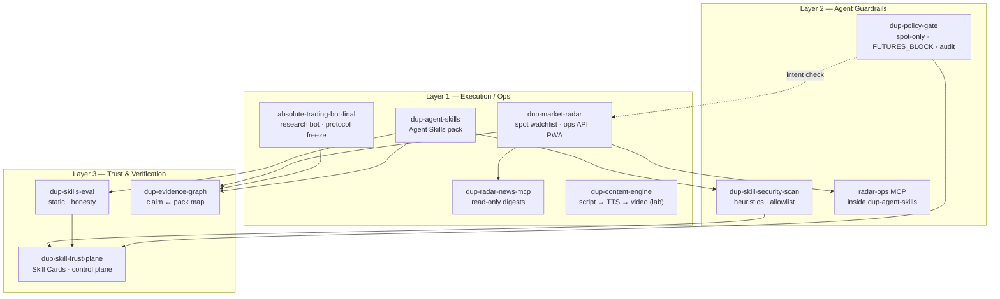

# Uladzimir Dabranski (D.U.P.) · DUP Labs

**Industrial fail-closed systems** for Agent Skills / MCP trust, market ops, and hybrid L1 R&D.  
Claims need packs on disk. No silent green. **Not financial advice.** Not a launched public mainnet.

---

## Простыми словами (для любого человека)

Здесь не «волшебный бот, который печатает деньги». Это набор **открытых программ** с жёсткими правилами:

| Если вы хотите… | Откройте этот репозиторий | Что получите за 5–15 минут |
|-----------------|---------------------------|----------------------------|
| Просто посмотреть экосистему | Этот профиль | Карту «что зачем» |
| Один клик собрать стек skills/MCP | [`dup-lab`](https://github.com/Gruver87/dup-lab) | Локальный стенд без ключей биржи |
| Смотреть рынок (спот / мемы / листинги) | [`dup-market-radar`](https://github.com/Gruver87/dup-market-radar) | Дашборд на `http://127.0.0.1:8787/` |
| Автопокупку спота (осторожно!) | тот же Radar + [`START_HERE`](https://github.com/Gruver87/dup-market-radar/blob/main/docs/START_HERE.md) | Opt-in, по умолчанию **выключено** |
| Понять, почему бот **не покупает** | [`absolute-trading-bot-final`](https://github.com/Gruver87/absolute-trading-bot-final) | Исследование; входы выключены |
| Проверку «можно ли доверять skill/MCP» | [`dup-skill-trust-plane`](https://github.com/Gruver87/dup-skill-trust-plane) | Карточки доверия + демо без ключей |

**Деньги на бирже:** только если вы сами положили API-ключи и явно включили торговлю. Ошибка или сбой — риск ваш. Фьючерсы ботами из этого стека **автоматом не торгуются**.

```text
Новичок (60 сек):  clone dup-lab → bootstrap → открыть в Cursor
Оператор Radar:    START_HERE.md в dup-market-radar (по-русски)
Техлид:            архитектура ↓ → pin order ↓ → honesty ↓
```

---

## Start here (automatic wiring)

```bash
git clone https://github.com/Gruver87/dup-lab.git && cd dup-lab
make bootstrap          # Windows: .\scripts\bootstrap.ps1
# Open dup-lab/ (or dup-lab.code-workspace) in Cursor — skills + MCP already connected
```

Orchestrator: [`dup-lab`](https://github.com/Gruver87/dup-lab) — clones siblings, installs skills globally, writes `.cursor/mcp.json`, runs fixture demos.

## Architecture (3 layers)



**Crypto / Market Radar is the first combat stand** — Trust & Guardrails are **generic** patterns for high-stakes Agent Skills / MCP (fintech, DevOps, regulated ops).

## Pin these (recommended order)

| # | Repo | Why pin |
|---|------|---------|
| 1 | [`dup-lab`](https://github.com/Gruver87/dup-lab) | **Start here** — one-command bootstrap |
| 2 | [`dup-skill-trust-plane`](https://github.com/Gruver87/dup-skill-trust-plane) | Control plane — Skill Cards, self-host API |
| 3 | [`dup-skills-eval`](https://github.com/Gruver87/dup-skills-eval) | Deterministic eval + E2E dashboard |
| 4 | [`dup-agent-skills`](https://github.com/Gruver87/dup-agent-skills) | Production skills pack under test |
| 5 | [`dup-policy-gate`](https://github.com/Gruver87/dup-policy-gate) | Spot-only policy before any order |
| 6 | [`dup-market-radar`](https://github.com/Gruver87/dup-market-radar) | Live ops stand people actually open |

> Pin in GitHub UI: Profile → Customize your pins → select the six above.

## One-command demos (no exchange keys)

```bash
git clone https://github.com/Gruver87/dup-skill-trust-plane.git && cd dup-skill-trust-plane
python -m pip install -e ".[dev]" && make demo   # Windows: .\scripts\demo.ps1

git clone https://github.com/Gruver87/dup-skills-eval.git && cd dup-skills-eval
python -m pip install -e ".[dev]" && make demo

git clone https://github.com/Gruver87/dup-evidence-graph.git && cd dup-evidence-graph
python -m pip install -e ".[dev]" && make demo

git clone https://github.com/Gruver87/dup-radar-news-mcp.git && cd dup-radar-news-mcp
python -m pip install -e ".[dev]" && make demo
```

## Repository map (полный)

| Layer | Repository | Role | Beginner doc |
|-------|------------|------|--------------|
| Entry | [dup-lab](https://github.com/Gruver87/dup-lab) | Bootstrap skills + MCP | README |
| Trust | [dup-skill-trust-plane](https://github.com/Gruver87/dup-skill-trust-plane) | Skill Cards / MCP listing ([M8ven](https://m8ven.ai/mcp/gruver87/dup-skill-trust-plane) = publisher verify, not paid audit) | [START_HERE](https://github.com/Gruver87/dup-skill-trust-plane/blob/main/docs/START_HERE.md) |
| Trust | [dup-skills-eval](https://github.com/Gruver87/dup-skills-eval) | Static / honesty gate | README |
| Trust | [dup-evidence-graph](https://github.com/Gruver87/dup-evidence-graph) | Can product X claim soak/ops_ready? | README |
| Guard | [dup-skill-security-scan](https://github.com/Gruver87/dup-skill-security-scan) | Install allowlist + heuristics | README |
| Guard | [dup-policy-gate](https://github.com/Gruver87/dup-policy-gate) | FUTURES_BLOCK · size caps | README |
| Exec | [dup-agent-skills](https://github.com/Gruver87/dup-agent-skills) | Market-ops Agent Skills + read-only MCP | README |
| Exec | [dup-market-radar](https://github.com/Gruver87/dup-market-radar) | Spot watchlist / Telegram / PWA / opt-in auto | [START_HERE](https://github.com/Gruver87/dup-market-radar/blob/main/docs/START_HERE.md) |
| Exec | [dup-radar-news-mcp](https://github.com/Gruver87/dup-radar-news-mcp) | Digest / funding MCP (read-only) | README |
| Exec | [absolute-trading-bot-final](https://github.com/Gruver87/absolute-trading-bot-final) | Spot research · **entries OFF** | [START_HERE](https://github.com/Gruver87/absolute-trading-bot-final/blob/main/docs/START_HERE.md) |
| Media | [dup-content-engine](https://github.com/Gruver87/dup-content-engine) | Script → TTS → short video (lab) | README |
| L1 | [dup-protocol](https://github.com/Gruver87/dup-protocol) | Industrial L1 pin (separate evidence) | README |
| L1 | [dup-protocol-experimental](https://github.com/Gruver87/dup-protocol-experimental) | R&D sandbox | README |
| L1 | [dup-protocol-v2](https://github.com/Gruver87/dup-protocol-v2) | Merge polygon / next-gen experiments | README |

### Older / separate trees (не путать с текущим стеком)

| Repo | Honest status |
|------|----------------|
| [absolute-blockchain-ultimate](https://github.com/Gruver87/absolute-blockchain-ultimate) / [absolute-blockchain](https://github.com/Gruver87/absolute-blockchain) | Legacy Absolute_* names — canonical L1 public pin is **`dup-protocol`** |
| [absolute-futures-bot](https://github.com/Gruver87/absolute-futures-bot) | Futures leverage bot — **out of scope** for DUP Radar auto; do not treat as current product |
| [trading-terminal](https://github.com/Gruver87/trading-terminal) | Older terminal UI — not the Market Radar stack |

## Honesty

- **Ops-ready ≠ 48h soak PASS** — soak only with sealed pack (`approx_48h_claim_ok` + `hard_fails=0`).
- **CI green ≠ ready to risk money.**
- **Futures auto always refused** in Radar / policy gate (`FUTURES_BLOCK`).
- **L1 mesh evidence ≠ Market Radar packs** — skill `l1-boundary`.
- Bot MEASUREMENT v1: **stopped** (no-edge); research branches are not an unlock.

## Contact

**Uladzimir Dabranski** · DUP Labs · [github.com/Gruver87](https://github.com/Gruver87)
